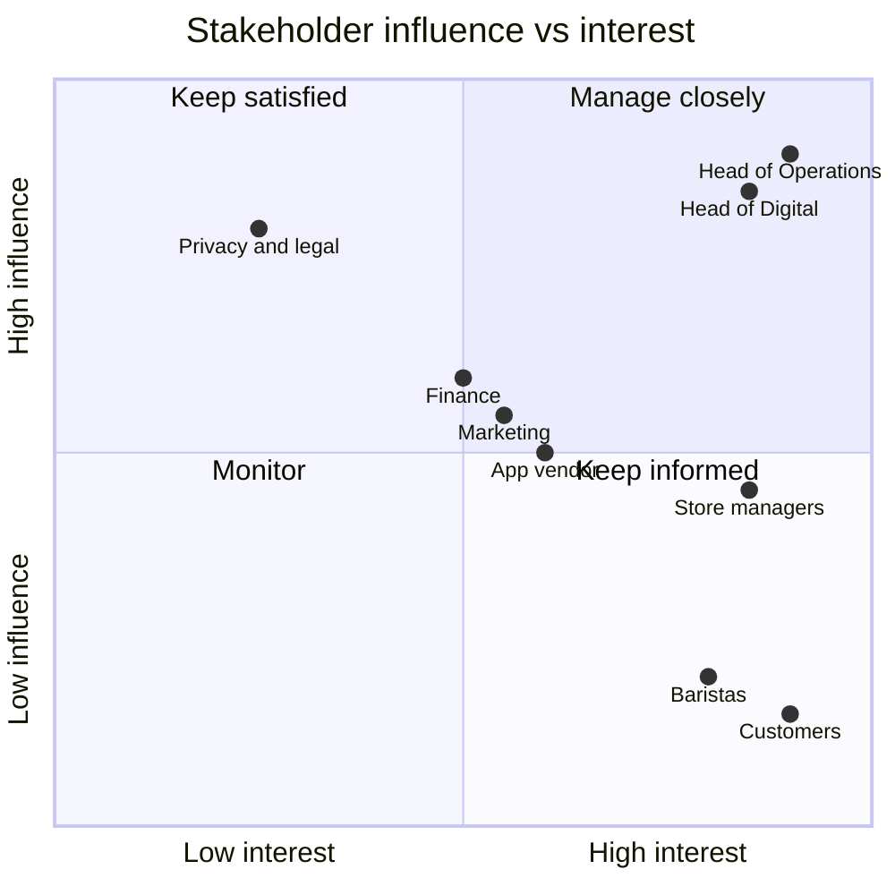

# 2. Stakeholder Analysis

## Stakeholder register

| Stakeholder | Role in project | Interest | Influence | Key concerns |
|-------------|-----------------|----------|-----------|--------------|
| Head of Operations | Sponsor | High | High | Peak throughput, staff workload |
| Store managers (40) | Users, subject matter experts | High | Medium | Bar workload, order accuracy, rollout disruption |
| Baristas and counter staff | End users (store side) | High | Low | Clear order tickets, not being overwhelmed |
| Customers (app users) | End users | High | Low | Speed, accuracy, easy payment |
| Head of Digital | Product owner for the app | High | High | App experience, release schedule |
| App development vendor | Delivery | Medium | Medium | Clear, testable requirements |
| Finance | Payments and reconciliation | Medium | Medium | Refunds, settlement, reporting |
| Marketing | Launch campaign, loyalty | Medium | Medium | Loyalty points, launch date |
| Privacy and legal | Compliance | Low | High | Customer data handling |

## Influence / interest grid

## Engagement plan

| Stakeholder group | Approach | Frequency |
|-------------------|----------|-----------|
| Sponsor and product owner | Steering check-in, decision log | Weekly |
| Store managers | Workshops, process walk-throughs in store | Twice during analysis, then fortnightly |
| Baristas | Observation at peak, short interviews | During as-is analysis |
| Customers | Short survey through the loyalty app | Once, before requirements sign-off |
| Vendor | Backlog refinement, story walk-throughs | Each sprint |
| Finance, privacy | Targeted reviews of payment and data requirements | At requirements review |

## Elicitation approach

- **Observation** at two high-volume stores during peak to time the current process
- **Interviews** with store managers and baristas, analysed thematically to group pain points
- **Workshop** with operations, digital and finance to agree scope and priorities (MoSCoW)
- **Survey** of app users to confirm demand and preferred pickup windows
- **Document analysis** of POS reports for peak order volumes
