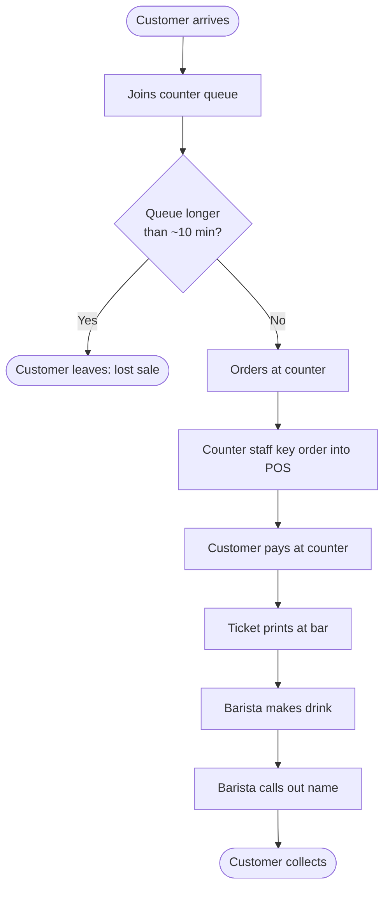
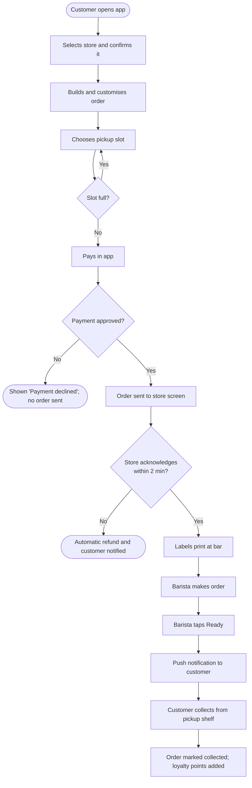

# 5. Process Maps

## As-is: counter ordering at peak

**Pain points found in observation and interviews**

1. Queue time drives walk-outs (step C).
2. Staff time at peak goes to taking orders and payments (steps E to G), not making drinks.
3. Called-out names are missed in a noisy store, leading to drinks left on the counter.

## To-be: click-and-collect through the app

## Gap analysis

| Area | As-is | To-be | Change needed | Requirement |
|------|-------|-------|---------------|-------------|
| Ordering | Counter only | App ordering ahead | App ordering flow | FR-01 to FR-05 |
| Payment | At counter | In app before arrival | Gateway integration | FR-05, NFR-03 |
| Bar workload | Unplanned peaks | Capped per slot | Slot throttling | FR-07 |
| Order handover | Name called out | Push notification, pickup shelf | Ready notification, shelf | FR-08 |
| Failure handling | Not applicable | Automatic refund | Acknowledgement timer | FR-10, NFR-04 |
| Measurement | Manual estimates | Daily report | Reporting | FR-12 |
