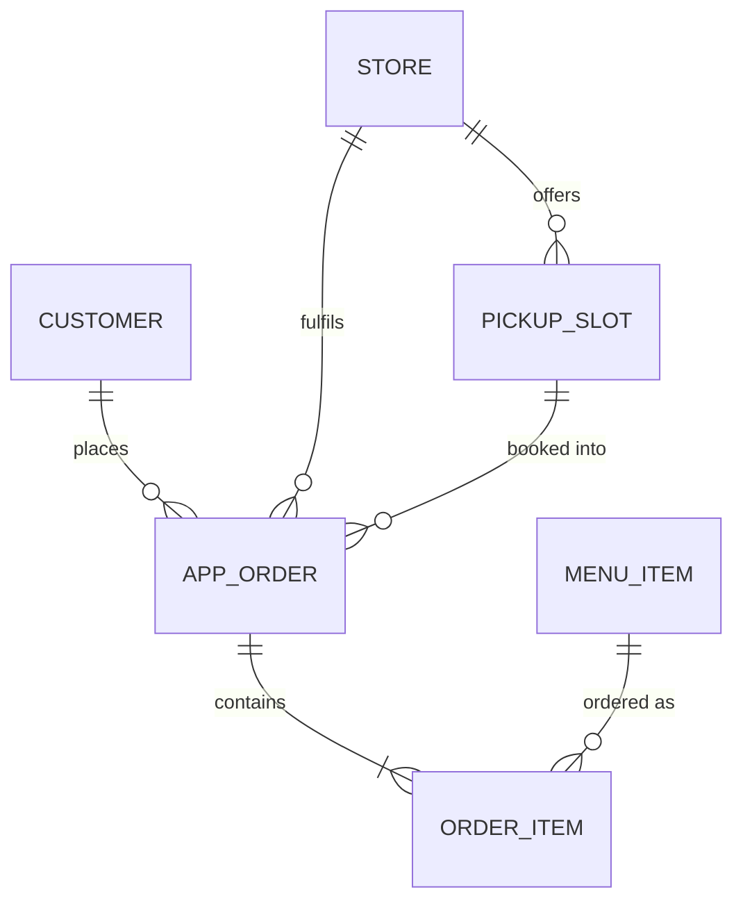

# 6. Data Requirements

## Entities

## Data dictionary (key fields)

| Entity | Field | Type | Rule |
|--------|-------|------|------|
| APP_ORDER | order_id | String | Unique, system generated |
| APP_ORDER | customer_id | String | Must exist in loyalty system |
| APP_ORDER | store_id | String | Must be an open store at time of order |
| APP_ORDER | pickup_slot_start | DateTime | 5-minute boundary, at least 10 minutes after order time |
| APP_ORDER | status | Enum | received, acknowledged, ready, collected, cancelled_refunded |
| APP_ORDER | payment_token | String | Gateway token only; card numbers never stored (NFR-03) |
| APP_ORDER | total_amount | Decimal(8,2) | Sum of item prices including option surcharges |
| APP_ORDER | acknowledged_at | DateTime | Null until store acknowledges; drives FR-10 timer |
| APP_ORDER | ready_at, collected_at | DateTime | Used for ready-to-collect time (FR-12) |
| ORDER_ITEM | options | JSON | Size, milk, shots, sugar; validated against store availability |
| PICKUP_SLOT | capacity | Integer | Set per store; slot is full when booked orders = capacity (FR-07) |

## Business rules

- **BR-R1** An order is only sent to the store after payment is approved.
- **BR-R2** If `acknowledged_at` is still null 2 minutes after payment, cancel and refund.
- **BR-R3** Loyalty points are credited only when `status = collected`.
- **BR-R4** A pickup slot is unavailable once its booked orders equal its capacity.

## Reporting (FR-12)

| Measure | Definition |
|---------|------------|
| App orders | Count of orders with status not `cancelled_refunded` |
| Ready-to-collect time | Average of `collected_at - ready_at` |
| Remakes | Count of items flagged "remake" at the bar |
| App share of peak orders | App orders / all orders between 7:00 and 9:30 am |
